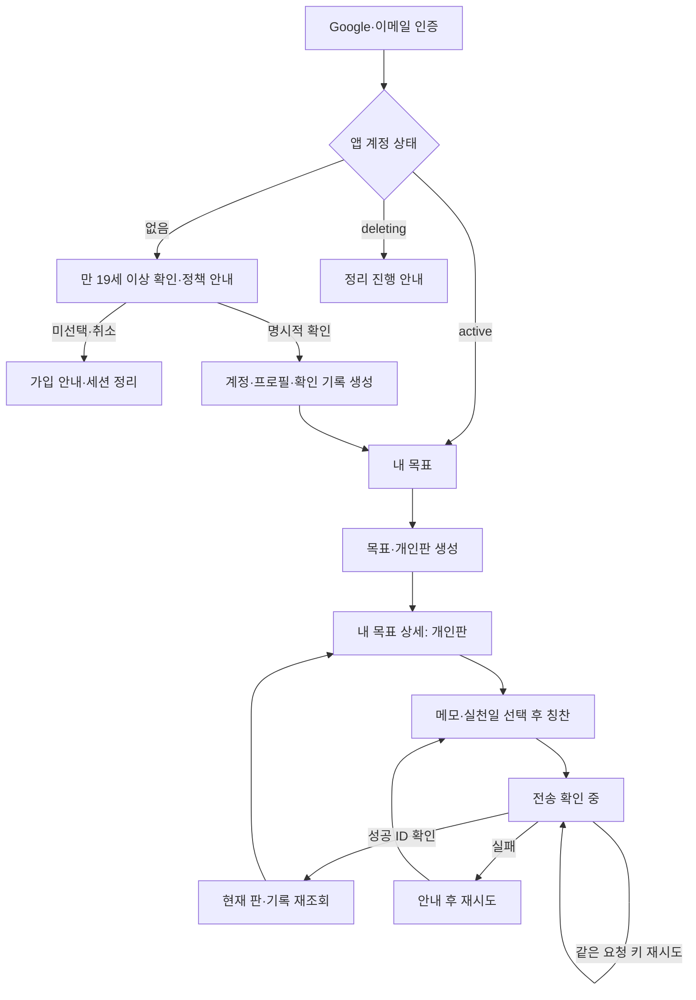
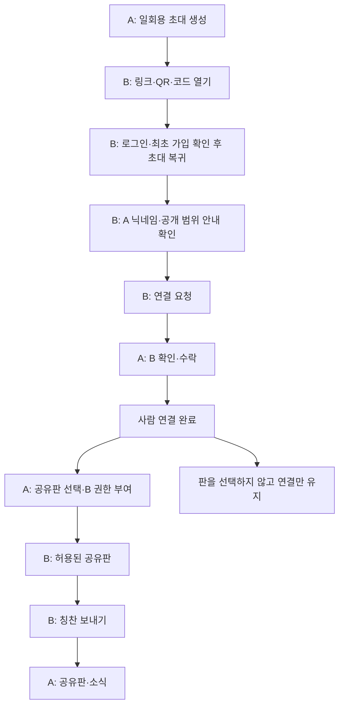
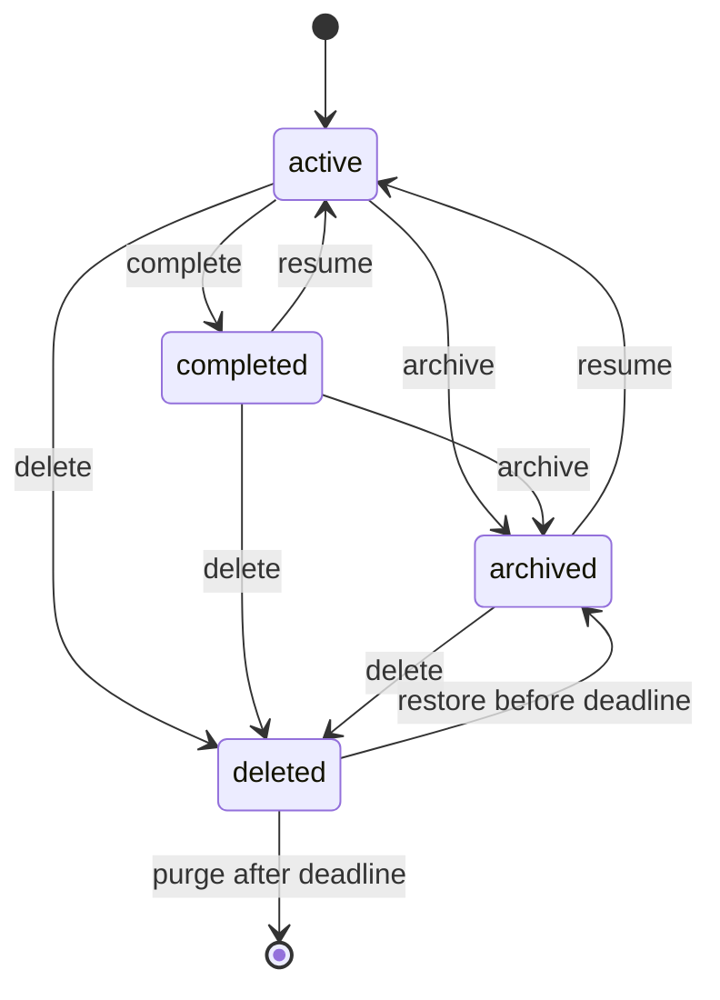

# 화면과 상태 흐름 설계

버전: 0.2.0 / 상태: W20-B 목업 UI02~UI05·UI07 재구성 및 UI08 포도 그래픽 구현·리뷰 완료(5개 폭·대비·실패 재시도 브라우저 확인). UI09 화면, TC-UI-MOCKUP-001 전체 수락, W15 실기기 접근성/PWA·제품 수락 검증은 미완료

정책: [제품 규칙](../policies/product-rules.md), [생명주기](../policies/data-lifecycle.md), [응답 필드](../policies/access-and-responses.md). 화면 이름·구성은 개발 기준이며 브랜드·색상은 후속 검토한다.

## 화면 단위

| 화면 ID | 화면·주체 | 표시 데이터·동작 | 빈/오류·완료 상태 | 요구 |
| --- | --- | --- | --- | --- |
| UI01 | 로그인·가입 확인 | 성인 개인 서비스 안내, Google·이메일 OTP, 최초 가입의 만 19세 이상 확인, 초대 복귀 | 확인 미선택·이전 정책은 가입 불가, 메일 지연·잘못된 번호·외부 브라우저 대안 | REQ-001 |
| UI02 | 판 고르기 (B01) | 판=목표 1:1, 이름·상태·기록 n/목표·공유 켬 배지, 새 판 만들기 | 빈 상태는 포도판 카드만 표시, 로딩·재시도 | REQ-002~004 |
| UI03 | 판 만들기·설정 (B02) | 이름 1~80자, 알 1~100 기본 20, 공유 기본 끔. 켬이면 같은 이름·개수의 공유판 동시 생성. 개인 메모·공유 설명은 더 보기 | 나중에 공유판 추가 불가, 이름 aria-invalid/describedby·상한·revision 충돌 | REQ-002 |
| UI04 | 내 판 (B04) | 판 이름 h1, 개인/받은 칭찬 탭·지난 회차, 독립 개수의 포도 그래픽·최근 기록 | active 기록 가능, 완성 회차의 다음 회차 시작, 완료/보관·재개 | REQ-003/004/012 |
| UI05 | 칭찬 입력·상세 (B05~B07) | 자동 날짜·시간/작성자, 태그 0~1개·메모, 실천일 접힘. 760px 이하 시트·그 이상 패널. 상세에서 수정·취소·peer 숨김/제외 | 저장 중 비활성·실패 입력 보존/같은 키 재시도, 성공 재조회 후 1회 pop, reduced-motion 정지 링/저장됨, 취소 확인 시트 | REQ-003/007 |
| UI06 | 연결·초대 | 링크/QR/코드, 요청 수락·거절·철회·차단 | 만료/사용 불가, 연결만 수락 가능 | REQ-005 |
| UI07 | 공유 패널 (B03) | 공유 켬 배지에서 연결 코드 메타·생성/마스킹/보기/복사/개별 폐기, 별도 contributor 허용·회수 | 활성 연결·50명 상한, 연결 코드와 판 권한 분리, 닫으면 원문 제거. 공유 끔은 상태 표시 | REQ-006 |
| UI08 | 지인의 공유판 | 기존 구조 유지, 공유 제목·공유 개수·회차별 읽기 전용 포도 그래픽·내가 보낸 칭찬, peer 메모만 입력 | 권한 없음은 접근 불가, 완료/보관은 읽기 안내 | REQ-004/006 |
| UI09 | 소식·보낸함 | 수신자 소식·읽음, 본인 peer 기록·취소 | 대상 삭제/권한 만료, 현재 상대 개수 비표시. W10-A API 완료, 화면은 후속 | REQ-008/009 |
| UI10 | 휴지통 | 목표 상세의 휴지통 이동, 본인 목표 제목·삭제/마감 시각, 복구 | 30일 이후 복구 불가, archived로 복구. 공유 권한은 즉시 회수되며 복구 시 다시 선택 | REQ-002/010 |
| UI11 | 계정 설정·탈퇴 | 프로필·시간대·로그아웃, 재인증·삭제 범위 설명 | 삭제 접수 후 접근 중단, 완료 시간은 목표로 안내 | REQ-001/010 |

UI06 연결·초대·요청·차단은 W09-A API와 W09-C 화면 구조를 유지한다. 일회 secret은 fragment를 처리하면 현재 주소에서 지우고 성공/취소 뒤 메모리 상태도 비운다. 연결 수락은 목표별 권한을 부여하지 않는다. UI07은 W20-B 공유 패널에서 활성 연결된 사용자를 판마다 별도로 허용/회수한다. UI08은 서버가 현재 grant를 확인한 공유판 목록에서 참여판을 열어 회차 수를 보고 자신의 peer 칭찬을 작성한다. 해당 화면에서 상대의 다른 기록과 개인 목표 원본은 노출하지 않는다. 목록은 `list_my_shared_boards`를 통해 현재 연결 generation·차단·grant를 재검사한다. 과거 구현·검사 범위는 [W09-C 증거](../quality/reports/w09-c-shared-board-ui-check-2026-10-08.json), 재설계 검증 상태는 아래 W20-B 절과 현재 검사 증거를 따른다.

UI10은 목표 상세의 “휴지통으로” 동작과 휴지통 탐색·복구를 제공한다. 삭제 전에 30일 복구 가능 기간과 즉시 회수되는 공유판 권한, 복구 후 권한이 돌아오지 않는 점을 안내한다. 휴지통 응답은 제목·삭제 시각·파기 시각·revision만 사용한다. 삭제 응답이 불확실하면 같은 revision으로 재시도할 수 있고, 서버는 이미 삭제된 목표에 기존 기한을 유지하며 replay한다. 복구 응답이 불확실하면 휴지통을 다시 읽어 최신 revision을 확인한다. 실제 브라우저 mutation submit은 fixture 보호를 위해 미실행이며 [W10-B 증거](../quality/reports/w10-b-goal-trash-api-ui-check-2026-10-08.json)에 기록한다.

W11-A에서 전역 색상 토큰을 의미 중심으로 분리하고 정원·포도 팔레트를 현재 화면에서 전환할 수 있게 했다. 선택은 현재 탭 상태로만 유지하며 사용자 설정이나 목표 데이터를 저장하지 않는다. 키보드 전환 smoke에서 선택 목표·개인/공유 진행 수가 유지되고 업무 API 쓰기가 없음을 확인했다. 접근성 전반·오류 흐름·PWA는 후속 W11 단위에서 검증한다.

W11-B1에서는 첫 Tab에 나타나는 “본문으로 건너뛰기” 링크를 추가해 주요 메뉴를 지나 목표·기록 영역으로 이동할 수 있게 했다. 목표·연결·공유판·휴지통 비동기 영역은 `aria-busy`로 로딩 의미를 제공한다. 연결 목록을 읽을 때 서버가 중단된 오류와 “다시 불러오기”를 확인하고 서버를 다시 시작해 읽기 상태를 회복했다. 로컬 읽기 전용 smoke이며 [검사 증거](../quality/reports/w11-b1-accessibility-recovery-check-2026-10-08.json)에 남긴다.

W11-B2에서는 760px 이하 주요 메뉴를 2열로 배치하고 각 메뉴를 44px 높이로 만든다. 320px·640px 화면에서 목표·연결·공유·휴지통의 가로 넘침, 연결 초대 버튼의 잘림, 정원·포도 테마의 텍스트 대비를 확인했다. 낮은 보조 글자색을 조정한 뒤 브라우저 측정 대상은 WCAG AA 기준을 통과했다. [검사 증거](../quality/reports/w11-b2-small-screen-contrast-check-2026-10-08.json). 실제 기기 확대·VoiceOver/TalkBack·터치 검증은 `TC-WEB-006`으로 추적 중이며 아직 실행하지 않았다.

W11-C에서 설치 매니페스트와 180/192/512 PNG 아이콘을 제공한다. 운영 빌드에서만 서비스 워커를 등록하며 immutable `/_next/static/` 자산과 공개 아이콘만 제한 캐시에 저장한다. 사용자 HTML은 `private, no-store`, 서비스 워커 코드는 `no-cache, no-store`다. 홈 이동이 오프라인이면 계정·기록이 없는 고정 안내 문서를 반환하고 API·RSC·초대 경로·query string·변경 요청은 서비스 워커에서 처리하지 않는다. 화면에는 온라인 연결 상태를 알리고 네트워크 실패 기록은 성공이 아니라 확인되지 않은 요청으로 안내한다. VM 기반 서비스 워커 경계 검사 `TC-CACHE-002`는 통과했다. 계정 A/B 전환, 실제 오프라인 기록 시도와 기기 설치 검증 `TC-CACHE-001`은 아직 실행하지 않았다. [검사 증거](../quality/reports/w11-c-pwa-cache-check-2026-10-08.json)

모든 핵심 화면은 목록 대안·키보드·읽기 도구·큰 글씨를 지원한다. 개인/공유를 색만으로 구분하지 않는다. 버튼은 현재 역할에 맞게 표시하되 실제 권한은 서버·DB에서 다시 검사한다.

## W20-B 목업 재설계

W20-B는 UI07 권한 관리를 목표 설정에서 공유 패널로 옮긴다. UI06·UI08·UI10의 기존 구조는 유지하고 공통 토큰/스타일만 바꾼다. 흰 바탕·검정 글자/선, 기본 포도 테마와 의미 토큰의 정원 전환을 사용하며 선택은 저장하지 않는다. 1~100알은 최소 삼각 행 수에서 차례대로 배치하고 현재 회차 valid_count만 채운다. 다음 빈 알은 포인터 단축 조작이며 키보드 주 조작은 그래픽 아래 전폭 “칭찬 남기기” 버튼이다.

성공 뒤 응답 bunch_id로 판·회차·목록을 재조회한다. 응답 ID가 최신 목록 맨 위에 있을 때만 마지막 재생 ID를 비교해 0.4초 pop을 한 번 표시한다. 완성 회차는 pop 대신 완성·다음 회차 안내, reduced-motion은 정지 링과 “저장됨”을 표시한다. 재확인 중에는 요청 내용과 판을 고정해 같은 키가 다른 판으로 전송되지 않게 한다.

공유 코드 원문은 생성 응답에서만 받아 패널 상태에 보관하며 닫으면 제거한다. 전체 초대 메타를 페이지 끝까지 읽어 상태를 확인한다. 이전 코드는 자동 폐기하지 않는다. 생성 실패 시 목록을 재조회하고 원문 복구 불가를 안내한다. STATE_CONFLICT 뒤 활성 초대 5개가 확인되면 상한 안내를 표시하며 사용 완료·만료·폐기는 메타로 구분한다. 현재 API가 세부 오류를 STATE_CONFLICT/OBJECT_NOT_AVAILABLE로 통합하므로 받은 코드의 실패 사유를 항상 구분하는 변경은 서버 범위 밖으로 남겼다. 사진·캡처·다른 판 종류·공유 중지·작성자 변경은 제공하지 않는다.

이전 W11 브라우저 통과 기록은 당시 소스의 증거다. W20-B의 5개 폭·대비·44px·reduced-motion·실제 저장 흐름 브라우저 검사는 Claude 리뷰에서 별도 실행한다. [현재 검사와 한계](../quality/reports/w20-b-mockup-ui-check-2026-10-15.json)

## 가입 확인

신규 Auth 사용자는 /signup에서 “저는 만 19세 이상입니다.”를 직접 선택한다. 기본값은 미선택이며 서버 확인 전에는 목표·초대 화면을 열지 않는다. 생년월일·전화·신분증 입력은 없다. API를 직접 호출해도 같은 확인·정책 검사를 수행한다. 취소하면 현재 인증 세션·임시 초대를 정리하고 가입 안내로 돌아간다. 기존 active 계정은 최초 확인 화면을 반복하지 않는다. 성인 확인과 실제 공개 약관·개인정보 관련 동의는 구분한다. [상세 정책](../policies/audience-and-signup.md)

## 첫 개인 기록

결과를 받지 못한 경우 기존 입력·요청 키를 유지한다. 사용자가 실패한 요청을 재시도할 때 새 키를 만들지 않는다. 입력을 새로 바꿔 독립 기록을 제출할 때만 새 키를 생성한다. 성공하기 전에 알을 확정 표시하지 않는다.

## 연결에서 공유 칭찬까지

연결 수락 화면에서 목표를 선택하는 UX를 제공할 수 있지만 연결 완료 뒤 명시적 grant 작업으로 실행한다. grant 실패는 연결까지 실패한 것으로 표시하지 않는다. 임시 초대 비밀은 해당 탭만 사용하고 처리·취소·로그아웃 시 제거한다.

## 목표 상태

active만 새로운 칭찬을 받는다. 회차 완성으로 목표를 자동 completed 처리하지 않는다. deleted는 일반 경로에서 접근 불가, 휴지통은 주인만 본다. 복구는 판 권한을 회복하지 않는다.

## 오류와 접근성

| 상황 | 사용자 안내·다음 행동 |
| --- | --- |
| 빈 공유판 | 칭찬이 아직 없음을 표시, 개인 기록은 계속 사용 |
| 완료/보관 목표 | 새 입력이 닫혔음을 표시, 주인에게 재개 제공 |
| 취소·제외 | 바뀌는 회차·개수와 되돌릴 수 없음 안내 |
| 숨김 | 개수 유지, 숨긴 기록 메뉴에서 복원 |
| 409 수정 충돌 | 최신 상태 다시 읽고 내용 확인 후 수정 |
| 401 | 현재 입력은 안전한 범위에서 유지, 로그인 후 다시 확인 |
| 404 | 접근할 수 없음·목록으로 돌아가기, 차단 여부 추측 안내 없음 |
| 429 | 서버 재시도 시각·대기 시간 |
| 503·전송 불확실 | 실패/확인 중을 구분, 같은 키로 상태 확인·재시도 |
| 오프라인 | 온라인 필요, 기록 성공으로 확정하지 않음 |
| 삭제된 원문 소식 | 원문이 없음을 안내, 비공개 본문 복제해서 표시하지 않음 |

UI02~UI05는 W08-D에서 local fixture API를 사용하는 기본 화면으로 구현했다. 실제 UI 쓰기 제출의 제품 수락, iOS/Android·메신저·큰 글씨·키보드 검증은 완료되지 않았다. TC-UX-001/002와 TC-CACHE-001은 W15에서 수행한다. 나머지 화면은 계속 설계 원본이다.
